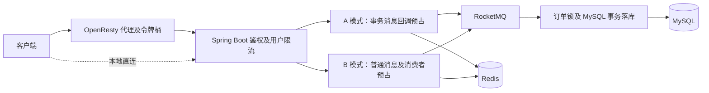
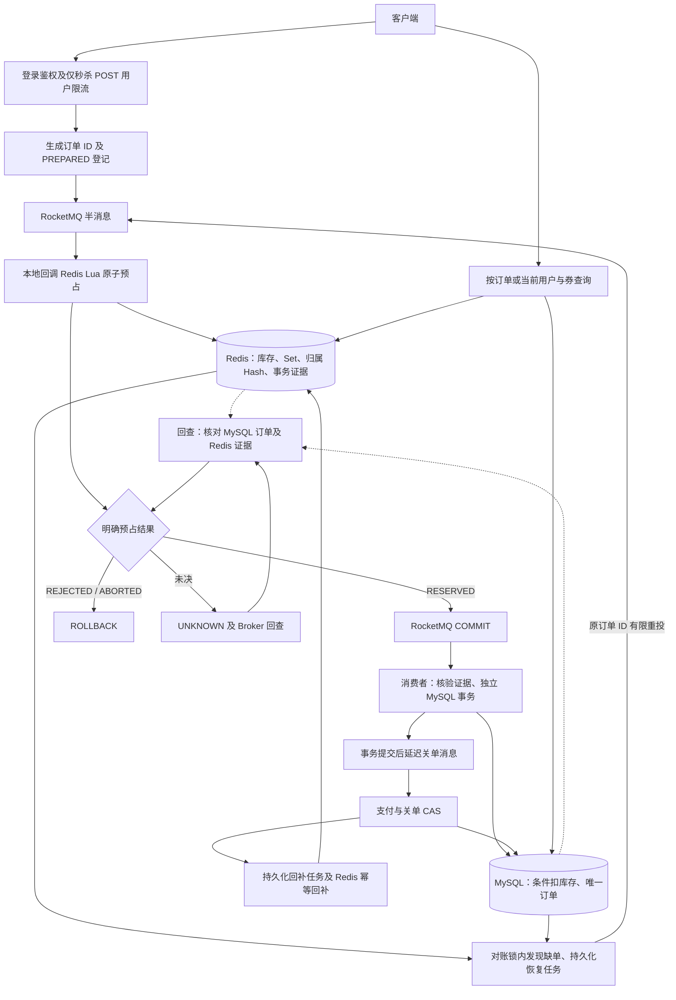

# HMDP-Pro

基于黑马点评课程项目的秒杀链路增强版。  
当前仓库：[soulbooyy/NearHub](https://github.com/soulbooyy/NearHub)

原项目：[30bef100w/hmdp-pro](https://github.com/30bef100w/hmdp-pro)

项目保留课程的商铺、用户和优惠券等业务，将秒杀统一为 **Spring Boot 单体 + Redis Lua + RocketMQ 事务消息 + MySQL 异步落库**。客户端直连 Java，只对秒杀提交做用户滑动窗口限流；不提供全局入口流量保护。

### 1. 单一秒杀提交链路

登录鉴权 → Redis ZSET + Lua 用户限流 → 生成订单 ID → PREPARED 登记 → 发送半消息 → 本地回调 Lua 原子预占 → COMMIT → 消费者独立 MySQL 事务落库。没有模式开关、消费者预占或订单创建分布式锁。

### 2. 事务消息与异常边界

事务记录只有 `PREPARED / RESERVED / REJECTED / ABORTED` 四种业务状态。明确预占成功才 COMMIT，明确拒绝或安全终止才 ROLLBACK；未决结果返回 UNKNOWN，Broker 后续回查。Lua 运行错误不会自动回滚已执行的写入，因此在库存修改前完成校验，并用 `writePending`、`review` 诊断标记阻止不确定记录再次扣减或自动终止。Broker 回查有次数上限，独立的持久化缺单恢复负责兜底。

### 3. 一人一单与消费幂等

预占 Lua 保留现有购买用户 Set 和 `userId → originalOrderId` 归属 Hash。消费者只核验预占证据，使用独立事务 Bean 执行 MySQL 条件扣库存与订单插入；主键和 `(user_id, voucher_id)` 联合唯一索引承担并发幂等。失败事务回滚后重新查库分类，异常继续触发 MQ 重试；无需订单创建 Redisson 锁。

### 4. 最小化缺单恢复与对账

已有对账锁下扫描预占记录，经过等待窗口后核验 RESERVED 及原订单归属，为缺单登记专用 MySQL 恢复任务。任务复用补偿任务的租约、有限重试与退避方式，通过事务消息通道重投**原订单 ID**，Lua 识别已有预占而不再次扣库存，确认 MySQL 已落库才完成。证据不足或重试耗尽进入诊断/人工核查，不自动覆盖库存。正常异步处理中 Redis 与 MySQL 库存可以暂时不同。

### 5. 延迟关单与持久化回补

建单事务提交后发送 RocketMQ 延迟消息，定时扫描兜底。到期关单 CAS、MySQL 回补和 Redis 回补任务在同一个 MySQL 事务中提交；后台通过归属校验及永久幂等标记 Lua 回补 Redis。取消后保留购买资格记录，不允许同一用户再次购买该券。

### 6. 支付与查询

支付只允许当前登录用户操作自己的订单，与关单使用 MySQL 状态 CAS 保证互斥。支持订单 ID 和当前用户+券 ID 两种查询；客户端丢失提交响应后也能找回已预占订单。不确定提交返回 HTTP 202 和原订单 ID，查询基础设施故障返回 503，不将临时不可用当作不存在。

### 7. Redis ZSET 用户滑动窗口限流

仅对 `POST /voucher-order/seckill/{id}` 使用 Redis **ZSET + Lua 滑动窗口**，按 `userId` 限制频率，默认每 1000 ms 最多放行 5 次。登录校验通过后执行限流；超限为 HTTP 429，限流组件 Redis 故障通过专用异常返回 HTTP 503，均不继续调用秒杀业务。结果轮询、支付、商铺查询等接口不占用额度。

**边界：** 10,000 个用户各提交一次时，都可能进入 Spring Boot 并访问 Redis；用户限流不控制系统总 QPS，也不能保护 Tomcat 或 Redis 免受总入口流量冲击。

### 8. 多级缓存

**问题：** 商铺详情多为 Redis → MySQL，热点仍反复打 Redis；更新后若只靠 TTL，脏读窗口偏长。  
**做法：** 商铺请求直接进入 Java，缓存读路径为 **Caffeine 本地缓存 → Redis（逻辑过期）→ MySQL**。冷缓存使用 Redisson 互斥重建和有限等待，逻辑过期通过有界线程池异步重建。商铺更新事务提交后删除 Redis 和当前 JVM 的 Caffeine；其他 JVM 通过默认 60 秒的本地 TTL 自然过期。Redis 逻辑过期基准缩短至 5 分钟，保留异步重建。此方案接受删除失败及并发旧值回填，不保证严格的最大不一致时间。

### 9. 读写链路分离

**问题：** 查询与秒杀写共用同步资源时，写路径拖慢读、读洪峰又挤占下单线程与连接。  
**做法：** 商铺读请求走多级缓存链路，不进入秒杀 Lua/事务消息路径；写请求走限流 + Redis 原子预占与事务消息 + MQ 异步落库 + 支付/关单/对账。这里的分离是业务链路隔离，不是 MySQL 主从复制。

------

## 运行

本地开发使用 **JDK 8 + Maven 3.9 + Docker Compose**。Java 在宿主机运行，MySQL、Redis、RocketMQ 在项目专用容器中运行。

```bash
cp .env.example .env       # 首次配置；已有 .env 时不要覆盖
./scripts/dev.sh up        # 启动依赖、等待健康检查、执行增量迁移、创建 MQ Topic
./scripts/dev.sh build     # 编译打包
./scripts/dev.sh run       # 前台启动应用，Ctrl+C 停止
```

脚本会加载 `.env`；没有该文件时会从示例创建。`.env`、`.local/` 和构建产物均不提交 Git。默认凭据仅用于本地开发，容器端口仅绑定 `127.0.0.1`。

| 服务 | 版本 | 本机连接地址 |
| --- | --- | --- |
| Java 应用 | Spring Boot 2.3.12 / JDK 8 | `http://127.0.0.1:8081` |
| MySQL | 8.0.45 | `127.0.0.1:13306`，数据库及用户均为 `hmdp` |
| Redis | 7.2 | `127.0.0.1:16379`，无密码，DB 0 |
| RocketMQ NameServer | 4.9.7 | `127.0.0.1:9876` |
| RocketMQ Broker | 4.9.7 | `127.0.0.1:10911`，另映射 `10909/10912` |

数据库密码见 `.env`。MySQL 和 Redis 避开本机常用端口，不复用其他项目的数据。首次创建 MySQL 数据卷时自动导入 `src/main/resources/db/hmdp.sql`；后续启动保留数据，不重复导入。原始课程 SQL 含零日期默认值，Compose 中为此设置了开发用 SQL mode。

### JDK 与 IDE

使用 JDK 8 编译和运行，项目旧版依赖尚未迁移到 JDK 17。可设置 `JAVA_HOME`，也可在 `.env` 中指定。脚本优先使用项目内 `.local/jdk8/Contents/Home`（macOS）或 `.local/jdk8`（Linux）。当前 Apple Silicon 开发机使用 Azul Zulu 8.0.504，安装位置为 `.local/jdk8/Contents/Home`，不会改变系统默认 Java。

IDEA 中将 Project SDK、Maven Importer/Runner JDK 和 Run Configuration JRE 均设为 JDK 8，并在运行配置中填写 `.env` 的环境变量（IDE 不会自动读取该文件）。工作目录设为项目根目录，启动类为 `com.hmdp.HmDianPingApplication`。上传文件默认保存至 `.local/uploads`，可用 `HMDP_UPLOAD_DIR` 覆盖。

RocketMQ 4.9.7 官方镜像为 amd64，Compose 已显式指定架构；Apple Silicon 通过 Docker Desktop 仿真运行。Broker 返回的地址配置为 `127.0.0.1`，适用于宿主机 Java；如果以后把 Java 也放进容器，需要同时调整 Broker 公告地址和客户端连接配置。

Apple Silicon 启动时，现有旧版 Netty 可能记录 `MacOSDnsServerAddressStreamProvider` 原生库加载失败并回退系统 DNS 的日志。当前配置使用本地 IP，已验证 Redis/MQ 连接正常；后续接入依赖域名的环境时需处理 Netty 的原生 DNS 依赖兼容性。

### 验证与日常操作

```bash
./scripts/dev.sh status
./scripts/dev.sh test
curl -fsS http://127.0.0.1:8081/shop-type/list
curl -fsS http://127.0.0.1:8081/shop/1
docker compose logs --tail=100 mysql broker
./scripts/dev.sh down     # 停止依赖并保留数据卷
```

`test` 运行现有的普通测试、Redisson 锁测试和商铺 GEO 数据加载测试，覆盖 Spring 上下文、MySQL/Redis 访问及锁连接；GEO 测试会向本项目 Redis 写入商铺坐标。请先启动依赖，并停止正在运行的 Java 应用，避免同机同组 MQ 客户端互相干扰。未默认运行生成 3 万 ID、写入百万 HyperLogLog 元素的练习测试。

`up` 会显式创建 `order-seckill-topic` 和 `canal-binlog-topic`。秒杀只有一条事务消息链路，没有模式配置。初始 SQL 没有秒杀券数据，验证秒杀流程前需要通过业务接口创建有效时间内的秒杀券。

客户端直接访问 Spring Boot，默认地址为 `http://127.0.0.1:8081`。当前未部署前端静态资源，也未启动 Canal binlog 投递服务。已有 Canal 消费者可以连接 MQ，但完整的数据库变更驱逐链路需要后续配置 Canal。

### 秒杀提交限流与入口迁移

拦截器顺序为 `RefreshTokenInterceptor → LoginInterceptor → SlidingWindowInterceptor`。路径规则集中在 `SlidingWindowInterceptor.SUBMISSION_PATH`（`/voucher-order/seckill/*`），由 `MvcConfig` 注册，并覆盖 Spring MVC 接受的同一接口尾斜杠形式；拦截器内部另行判断 POST 方法。`GET /voucher-order/seckill/result/{orderId}` 不匹配该单层路径，不执行限流脚本。

配置沿用 `seckill.rate-limit.sliding-window`：`enabled: true`、`window-ms: 1000`、`max-requests: 5`，启用时窗口和额度必须为正数。Key 为 `rate:sw:seckill:{userId}`，同一用户对不同券的提交共享额度。Lua 原子删除窗口外记录、计数、写入唯一请求并设置物理过期；窗口边界为 `(now - windowMs, now]`。仅记录放行请求，后续业务失败不退还额度；拒绝请求不增加记录、不续期。

`SlidingWindowRateLimiter` 只在自身 Redis 操作处捕获数据访问异常，包装为 `RateLimitUnavailableException`，由统一异常处理器返回 HTTP 503 与现有 `Result.fail` JSON。脚本无结果或返回非法结果也视为限流不可用。正常超限为 HTTP 429；其他组件的 Redis 异常不被改写成限流故障。若登录态读取先发生故障，仍沿用登录链路现有异常处理，不属于限流 503 的范围。

本次已移除 OpenResty 配置及令牌桶代码。原 Compose 不含该服务，基础环境无需迁移；外部环境若曾部署，需要先切换调用地址并验证，再停用旧实例。仓库删除不会自动停止外部服务。独立前端接入时按实际部署处理 API 地址与跨域。

```bash
./scripts/dev.sh test-rate-limit
./scripts/dev.sh test-orders
```

请先启动本地 Compose Redis/MySQL。`test-rate-limit` 使用真实 Redis DB 14 与唯一测试 Key，覆盖并发额度、独立用户、窗口边界及自动过期；MVC 测试使用真实注册规则，覆盖 POST 判断、结果查询和其他路径不触发限流、401/429/503 及业务异常不被误分类。`test-orders` 覆盖单链路提交回归，验证放行后库存与订单流程、超限和限流故障无业务副作用，以及额度耗尽后仍可查询结果；MQ 传输使用 mock，不代表真实 Broker 端到端测试。

### 重构前后架构

重构前（历史结构，仅用于对照）：OpenResty 可选部署，双模式分别在生产端或消费端预占，订单创建还使用 Redisson 锁。



重构后：以下 Java 节点均在同一个 Spring Boot 应用内，Redis、MySQL 和 RocketMQ 为已有外部依赖。



回查调用同一 Lua 的只读检查/超时终止动作，不执行新的预占；恢复消息回调命中 RESERVED 后也不再次扣减。库存差异只读核查，未提供按差额直接改库存的自动修复。

### 商铺更新与轻量缓存失效

`ShopServiceImpl.update()` 在数据库事务内更新商铺并发布进程内事件；`ShopCacheInvalidationListener` 使用 `@TransactionalEventListener(AFTER_COMMIT)`，仅在最外层事务成功提交后同步删除 Redis，再清理当前 JVM 的 Caffeine。事务回滚、不存在的商铺更新以及事务外事件均不触发失效。

Redis 删除失败时，`finally` 仍清理当前 JVM 的 Caffeine；监听器记录 `SHOP_CACHE_INVALIDATION_FAILED`，不将已经提交的业务更新报告为回滚。事件不持久化，进程在提交后、清理前退出可能丢失失效动作。现有 Canal 消费路径仍可调用驱逐方法，但本方案不依赖 Canal 或跨 JVM 广播。

| 配置 | 默认值 | 含义 |
| --- | --- | --- |
| `cache.shop.local-ttl-seconds` / `SHOP_LOCAL_TTL_SECONDS` | 60 | Caffeine 写入后过期，读取不会续期；其他 JVM 自然淘汰旧值 |
| `cache.shop.redis-logical-ttl-seconds` / `SHOP_REDIS_LOGICAL_TTL_SECONDS` | 300 | 商铺主查询 Redis 逻辑过期基准；沿用 0～20% 随机延长，实际约 5～6 分钟 |

Redis 商铺对象仍不设置物理过期；逻辑过期后返回旧值并尝试异步重建，过期旧值不重新填入 Caffeine。已有 Redis 数据保留原逻辑截止时间，配置修改在下次写入或重建时生效，不会批量改写存量缓存。课程对照查询 `queryByIdHeimaRedis` 的缓存策略未调整。

这是面向商铺详情读多写少、允许短暂旧数据的取舍：没有引入事务 Outbox、数据库版本号、Lua 版本校验、Pub/Sub 或本地版本水位。提交后删除不能阻止先读到旧数据的查询稍后回填；Redis 删除失败、提交后崩溃或异步重建持续失败也可能延长旧数据窗口。**60 秒本地 TTL 和 5 分钟逻辑过期都不代表严格的最大不一致时间**，应结合命中率、数据库负载和业务可接受窗口调整。

### Java 缓存重建锁与资源控制

`MultiLevelCacheService` 的同步回源和异步重建统一使用已有 Redisson 客户端，锁键为 `lock:cache-rebuild:{完整缓存键}`（例如 `lock:cache-rebuild:cache:shop:1`）。获取、查库、写缓存与释放由同一个线程完成；只在成功获取锁后清理，解锁由 Redisson 原子校验持有者，不直接 DEL 或 forceUnlock。不指定固定租期，使用 watchdog 续期；清理锁时临时清除线程中断标志，清理后恢复，避免旧版 Redisson 在中断状态下跳过正常释放。

- 冷缓存默认最多等待锁竞争 200 ms。无论是否取得锁，都会复查 Redis（包括空字符串代表的空值缓存）；未取得且仍未命中才抛 `CacheRebuildBusyException`，全局处理器返回 HTTP 503 和现有 `Result.fail` 格式。线程中断时恢复中断标志并结束请求，不递归重试、不无锁查数据库。200 ms 不包括 Redis 命令和数据库 IO 的完整耗时。
- 已有逻辑过期数据时，继续返回旧值并尝试异步重建，不因抢锁失败或队列满返回 503，也不把旧值重新放进 Caffeine 获得新有效期。工作线程真正开始执行后才获取锁，并二次检查是否仍需查库。
- 使用 Spring `ThreadPoolTaskExecutor`，默认固定 10 个线程、队列容量 200，拒绝策略为 AbortPolicy；提交失败记录 `CACHE_REBUILD_REJECTED`，保留当前请求的旧值响应。`ConcurrentHashMap.newKeySet()` 对同一 JVM 的同一缓存键去重，任务结束或提交失败时清理；没有持久化任务队列或分布式任务表。
- 重建成功后清除当前 JVM 的对应 Caffeine 项；数据库确认商铺不存在时写短期空值缓存。数据库异常不写空值，记录 `CACHE_REBUILD_FAILED`，后续请求可以重新触发。
- 关闭线程池时中断执行中的任务、丢弃尚未执行的任务，并最多等待配置的关闭时长。不能强制终止不响应中断的数据库调用，数据库连接与查询超时仍需单独配置。

`application.yaml` 中的 `cache.rebuild` 提供 `lock-wait-ms: 200`、`threads: 10`、`queue-capacity: 200`、`shutdown-wait-seconds: 5`。这些是初始值，线程数应结合数据库连接池容量、普通请求负载和压测结果调整。

升级时先停止旧应用及旧异步重建任务，再统一启动新版本。新锁使用 Redis Hash，不能与旧 `lock:shop:*` 字符串锁共用键；新旧版本使用不同锁名，也不能相互排斥。本轮未改课程演示用 `CacheClient`。

**Watchdog 不提供旧写入隔离。** 长时间 GC、Redis 连接异常或锁丢失后，旧线程恢复时仍可能写入先前查询的数据。Redisson 解决锁归属与误删问题，不代替更新事务与缓存失效协议，也不保证多 JVM 的缓存即时一致。

```bash
./scripts/dev.sh test-cache
```

请先启动本地 Compose MySQL 和 Redis。`test-cache` 创建独立的 `hmdp_cache_test` 数据库并复制商铺表结构，缓存数据使用 Redis DB 14；测试使用唯一 ID，并只清理自己的数据，不启动 MQ 或定时任务。

重建锁测试使用两个独立 Redisson 客户端和两份本地缓存，数据库回源使用可控函数及同步屏障，复现竞争、延迟和异常。覆盖锁归属、超时复查（含空值和逻辑过期值）、线程中断、watchdog 跨越原十秒租期、旧持有者退出、队列拒绝后恢复、异步二次检查、失败重试及关闭清理；MockMvc 验证 HTTP 503 契约。

另有真实 MySQL/Redis 集成测试，通过 Spring 事务代理验证提交前保留缓存、提交后按顺序清理、外层回滚不清理、Redis 删除失败仍清理本地，以及无效更新和事务外事件不清理。验证本地默认 60 秒 TTL、另一份缓存自然过期及主查询使用新的 Redis 逻辑期限。测试不等同于真实多 JVM 或生产压测，也不证明不存在旧值回填。

### 事务证据、结果查询与恢复

`SeckillReservationService` 统一执行 `seckill.lua` 的 PREPARE / RESERVE / CHECK 协议。事务 Hash 保存订单、用户、券、状态、创建时间和截止时间；库存与归属写入前设置 `writePending=1`，全部完成后设置 RESERVED 并清除此标记。`review=1` 表示证据冲突。这两个字段是诊断保护，不是可自动流转的额外业务状态。

| 业务状态 | Broker 回查 | 处理 |
| --- | --- | --- |
| PREPARED | UNKNOWN | 默认 60 秒未预占且没有写入未决/归属冲突时，Lua 原子改为 ABORTED；迟到回调不能再预占 |
| RESERVED | COMMIT | 核对身份和 Set/Hash 归属；相同订单回调不再扣库存 |
| REJECTED | ROLLBACK | 明确库存不足或重复购买，且没有本订单合法预占 |
| ABORTED | ROLLBACK | 已确认安全终止 |
| 缺失、过期、类型异常、身份冲突或写入未决 | UNKNOWN | 不自动回滚消息或重新预占，诊断/人工核查 |

回查首先检查 MySQL 中同 ID 的订单，身份一致的已落库订单可确认 COMMIT。Redis 事务、归属与回补标记均不设置自动 TTL：PREPARED 的“超时”是业务截止时间，并非删除 Key；终态记录保留供回查、查询和恢复。发送前登记遗留的 PREPARED 会由回查或定时对账终止。当前尚无归档协议，需要监控存储增长，不能直接删除未完成记录或永久幂等证据。Redis 记录全部丢失时，不保证自动还原缺单。

| 接口 | 结果 |
| --- | --- |
| `POST /voucher-order/seckill/{id}` | 正常预占返回订单 ID；发送/回调不确定返回 HTTP 202，data 含 `orderId`、`status: UNKNOWN` |
| `GET /voucher-order/seckill/result/{orderId}` | 只允许查看当前用户自己的记录 |
| `GET /voucher-order/seckill/result/by-voucher/{voucherId}` | MySQL 优先，否则根据现有归属 Hash 找回原订单 ID；不增加客户端 Token |

查询状态为 SUCCESS（MySQL 已落库，另含 orderStatus）、PROCESSING、REJECTED、UNKNOWN、MANUAL_REVIEW 或 NOT_FOUND。NOT_FOUND 只表示本次健康读取未发现记录，不证明从未预占；如果已知归属但事务缺失，返回 UNKNOWN/人工核查。Redis/MySQL 查询失败为 503。查询接口不占限流额度；没有订单 ID 且尚未取得购买资格的 PREPARED 不提供按券检索。

### 消费落库的事务与重试

`VoucherOrderPersistenceService` 在独立 Spring Bean 的 MySQL 事务中执行幂等查询、条件扣库存、订单插入。不持有订单分布式锁。唯一键冲突离开事务代理并完成回滚后重新查库分类，不手工增加库存抵消已回滚事务。

- 同订单号重投：核对用户与券，复用已落库订单；未支付订单继续延迟消息发送，不重复扣库存。
- 同订单号身份冲突、不同订单号占用同一用户购买资格：抛出异常，不能把错误订单号标记成功。
- 消费端只检查合法预占，不再运行预占动作。Redis 已预占而 MySQL 库存不足时保留预占、抛异常并触发 MQ 重试，不盲目回补。
- `ORDER_MAX_RECONSUME_TIMES` 默认 3。处理失败返回 `RECONSUME_LATER`；Broker 重试耗尽后进入死信流程，日志提示 `ORDER_MANUAL_REVIEW`。事务回查与消费重试都不是无限保障，缺单恢复独立运行。

`tb_seckill_recovery_task` 是专用恢复表。对账使用 SCAN 检查事务记录，默认 RESERVED 超过 60 秒且缺单才登记；库存与归属未迁移，仍使用现有 Set + Hash。每 5 秒读取最多 100 个到期任务，CAS 领取 60 秒租约；无跨 Redis/MQ 的数据库长事务。

恢复前再次核验身份、预占和 MySQL，发送前持久化尝试次数（默认最多 5 次，含发送前故障尝试），30 秒起步、最多 600 秒退避。复用事务消息通道、原订单 ID 和已有 RESERVED 决策，不创建新 PREPARED。发送成功后仍为 PENDING，只有读到同身份 MySQL 订单才 DONE。最后一次发送后保留一次落库确认机会；仍缺单则 MANUAL_REVIEW。重复发现不重置次数或终态；完成/失败更新校验租约令牌和有效期。即使租约过期产生重复投递，预占和 MySQL 幂等仍须成立。

自动恢复只覆盖仍有完整预占证据的缺单；不覆盖任意数据损坏。人工核查应结合原消息/DLQ、恢复/回补任务、两侧库存和归属。恢复任务本身不释放预占，也不删除购买资格。定时 SCAN 每轮仍遍历全部事务记录，批量 COUNT 只是扫描提示；这是当前项目规模下的简单实现，大量历史证据积累后的扫描成本尚未压测。

### 升级兼容边界

这是协议切换，不支持新旧版本混跑。先停止旧入口，在旧版本中排空/核查旧普通消息、半消息和消费重试，再停止旧消费者，核对存量预占，执行增量迁移后统一上线。旧事务 String 标记不能直接当作新事务 Hash 使用；没有身份与预占证据的历史记录不能自动转换或恢复。保留现有 Set/Hash，不批量重置库存。旧订单锁配置与模式环境变量应删除；客户端改为直连 Java。回滚版本同样需要先核账，不能让旧脚本覆盖新协议。

### 关单事务与 Redis 回补

关单截止时间固定为数据库 `create_time + 15 分钟`，订单创建时间使用 MySQL 默认值。延迟消息发送使用数据库当前时间计算剩余时长，选择 RocketMQ 延迟档位；过期立即投递，提前到达则重新调度。实际关单 SQL 同时校验 `status=UNPAID` 和数据库时间是否到期，消息内容和应用机器时钟不能让订单提前关闭。重复发送不会重新给予订单 15 分钟；15 分钟规则的变更需要单独考虑存量订单。

`VoucherOrderCancellationService` 在 Spring 事务中完成以下三个操作，任何一步失败都回滚：

1. CAS 将已到期的未支付订单改为已取消。
2. MySQL 库存加一，并检查受影响行数。
3. 向 `tb_order_stock_compensation` 插入以 `order_id` 为主键的 `PENDING` 任务。

事务提交后，MQ 即可确认关单消息；Redis 故障由持久化任务继续恢复。`OrderStockCompensationWorker` 默认每 5 秒扫描最多 100 条任务，以数据库 CAS 领取 60 秒租约，每次领取计入尝试次数。完成和失败更新都校验租约令牌及有效期，旧执行者不能覆盖新执行者的进度；执行期间不持有跨 Redis 调用的数据库事务。

- Lua 校验库存、购买集合、原订单归属及键类型，再执行库存加一和写入 `seckill:stock-returned:{orderId}`。回补标记包含券、用户和订单信息，**永久保留，不设 TTL**。重复执行命中该标记只返回成功；Redis 响应丢失或任务完成状态写入失败时可重试。
- 瞬态异常使用 30 秒起步、最大 600 秒的退避，默认最多尝试 10 次（包括首次）。耗尽或发现缺失/冲突/带 TTL 的归属、库存、标记时进入 `MANUAL_REVIEW`，保留错误和次数供核查，记录 `STOCK_COMPENSATION_MANUAL_REVIEW`。配置在 `seckill.compensation`。
- 取消后只回补库存，保留购买集合、归属及数据库唯一键，**不恢复同一用户再次购买该券的资格**。
- 历史已取消订单如果没有任务，再次收到关单请求时只记录 `STOCK_COMPENSATION_MANUAL_REVIEW`，不自动补建任务或重复返还库存。人工处理前必须核查原订单、两侧库存、预占归属和回补标记，不能直接重置任务并盲目重放。

此实现使用专用数据库任务表，没有引入通用 Outbox 框架或新 MQ Topic。它提供正常数据保留前提下的幂等重试与故障恢复，不保证 Redis 数据丢失后的自动恢复。永久标记不能被随意清理、过期或逐出；本地 Redis 配置 AOF 和 `noeviction`，仍不能替代备份与核账。Redis 恢复备份、丢键或重新初始化库存前，应暂停秒杀入口、消费者和补偿执行，核对库存及全部回补记录后再恢复。将来清理历史任务、归属或标记，需要先建立归档和禁止旧任务重放的规则。

已有环境升级时，先停旧应用和消费者，再执行以下**增量迁移**并统一启动新版本。`up` 也会执行同一迁移；新建数据卷会自动建表。不要重新导入包含建表重置操作的课程初始化 SQL：

```bash
./scripts/dev.sh migrate
```

迁移文件为 `src/main/resources/db/migrations/V002__order_stock_compensation.sql` 和 `V003__seckill_recovery_task.sql`，只新增回补/恢复任务表，不自动回填历史订单。运维应持续检查 `MANUAL_REVIEW`、长期 `PENDING` 和过期 `PROCESSING` 任务，不能仅以 MQ 已确认判断 Redis 已回补。库存对账现为只读估计和日志告警，未接外部告警平台。

### 订单链路测试

```bash
./scripts/dev.sh up
./scripts/dev.sh test-orders
```

`test-orders` 为本地 Compose MySQL 创建独立的 `hmdp_order_test` 数据库，复制订单与秒杀券表结构并执行两张任务表迁移；Redis 使用 DB 15。测试使用唯一 ID 并清理自己的数据，不启动定时调度或真实 MQ 消费者。

覆盖 MySQL 回滚/条件库存/并发唯一键、Redis 预占重放与部分写入注入、事务回查方法、HTTP 提交和双查询、支付关单竞争、幂等回补、恢复任务有限重投、租约接管和旧令牌隔离。数据库子进程测试验证 JDBC 事务中断回滚/提交后重放；生产者恢复测试使用新监听器对象，不等于真实生产者进程重启。

**MQ 传输为 mock，未进行真实 Broker 故障注入、完整网络端到端演练或性能压测；没有 QPS、P95/P99 结论。** 已执行测试、每阶段修改和尚未验证的风险见 [分阶段重构记录](docs/seckill-refactor.md)。

如果这个项目对你复习高并发或准备面试有帮助，欢迎点一颗 Star 支持一下。
